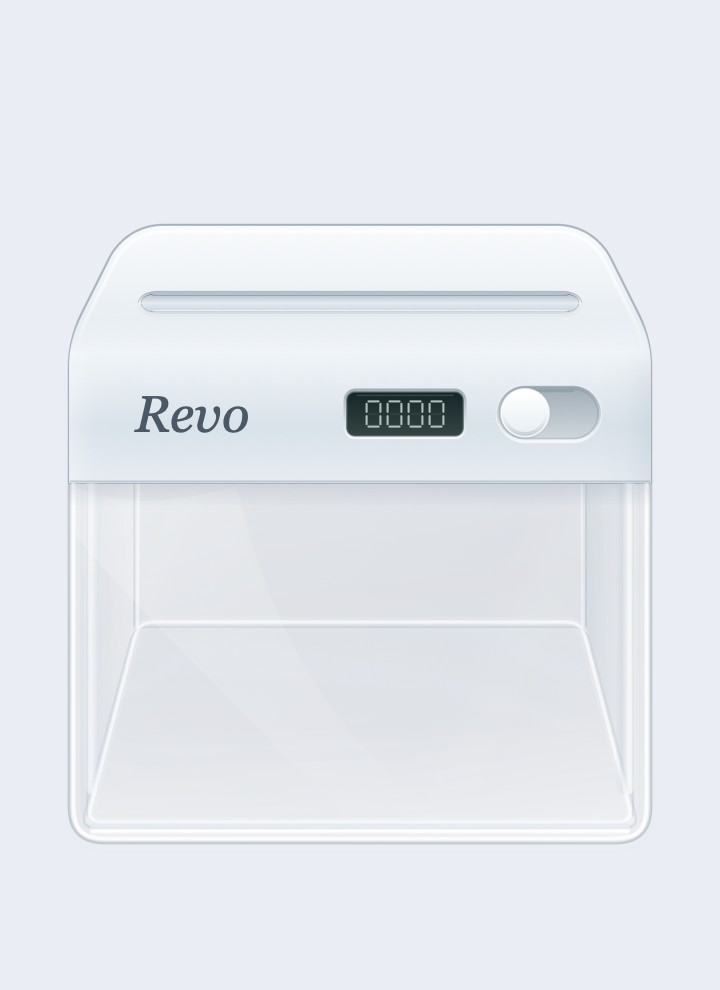
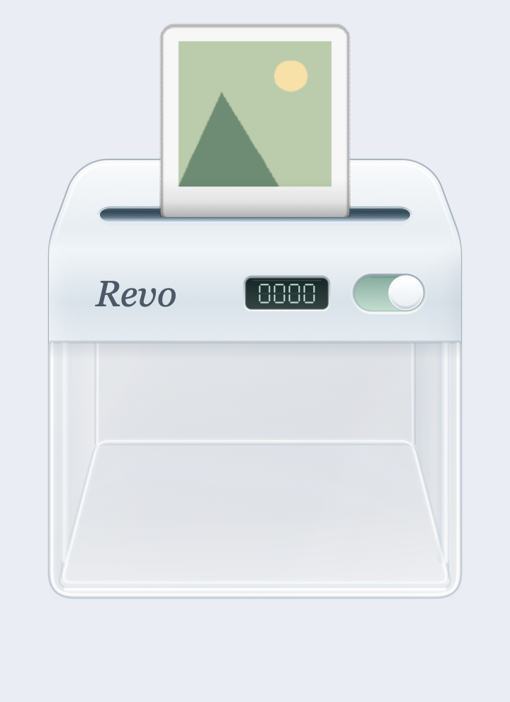
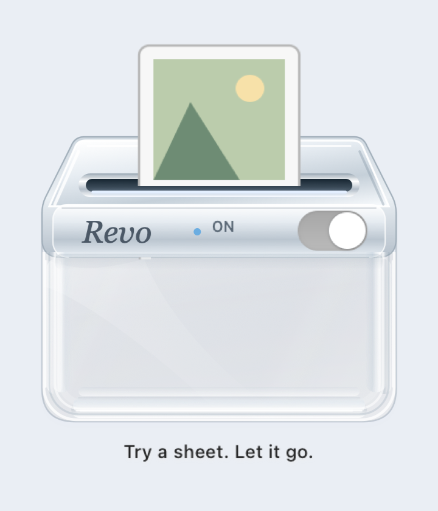

# Revo

A tiny native macOS desktop companion that turns letting go of files into a small, tactile ritual. Turn Revo on, drop a file into the slot, and watch it become paper scraps. The real file moves to macOS Trash and remains recoverable.

<p align="center">
  
  
  
</p>

## The little machine

A solid silver head, clear glass enclosure, layered edge reflections, and a compact tactile power switch. Its raised silver thumb slides into a soft mint-green track when on and returns to silver-gray when off. A recessed seven-segment display beside it shows the number of files successfully recycled today, including across app launches. Undo reduces the count; demos and failed operations never increase it. A gently elevated viewpoint reveals the receding top plane and a continuous metal front face. The metal head has softly rolled shoulders and a continuous front face above a taller glass enclosure. Larger file previews ease toward the inlet, catch briefly in the rollers, then feed in slowly at a steady pace. A curved, segmented paper surface compresses and darkens near the opening to give the bite depth. The roller catch and motor sounds follow those phases; heavier files and folder stacks feed more slowly. The entire head, including its bevels and end caps, is opaque aluminum. The lower enclosure combines subtle native desktop diffusion with a clear center, curved reflections, and a thick liquid-glass rim. Its side walls and floor recede toward the same vanishing point as the metal top, and paper scraps settle across that floor. Reduce Transparency replaces the glass with a solid native backdrop. The capsule inlet uses a narrow upper shadow, blue-gray interior gradient, and a soft silver reflection along the lower lip. The metal inlet and glass highlights are drawn in code with AppKit. Core Animation handles the paper feed, cutting, falling scraps, and subtle mechanical feedback. The only branding is Revo, set in Georgia Italic. The compact desktop panel measures 216 × 297 points.

- Documents become narrow paper strips.
- Photos use a thumbnail and break into confetti.
- Audio becomes a printed waveform.
- Video becomes perforated film strips.
- Folders feed a stack of sheets.
- Files larger than 200 MB feed more slowly.

Revo starts in English. Use the **Language** submenu in the right-click or menu bar menu to choose English, Simplified Chinese, Japanese, Korean, Russian, or French. Each language appears under its native name. Menus reserve enough width for full localized titles, and settings entries have no trailing ellipsis. The selected language persists across launches.

No dependencies, accounts, network calls, or analytics.

## License

Copyright (c) 2026 zhanglily99. Revo uses the custom [Revo Noncommercial Attribution License](LICENSE).

Free personal use, learning, and noncommercial modification and sharing are permitted. Redistributions of original or modified versions must include the full license, retain the author credit and project source link, and identify modifications. Commercial use, including sales, paid redistribution, or incorporation into a commercial product or service, requires prior written permission from the copyright holder. Attribution alone does not permit commercial use.

This is not the MIT License or an OSI-approved open source license. The license does not require publishing source code. For commercial permission, contact [zhanglily99](https://github.com/zhanglily99). The build script includes the full license at `Revo.app/Contents/Resources/LICENSE.txt`.

## Use Revo

Open `build/Revo.app`. Revo appears near the bottom-right corner of your desktop, with its power switch **off**.

Turn the switch on before dropping files. When off, Revo rejects drops and closes the inlet shutter. Power is never remembered across launches. Switching off during a batch discards all waiting jobs; the one file operation already in progress finishes. Turning it on again does not resume discarded jobs. Drag those files in again if you still want to recycle them.

| Gesture | Action |
| --- | --- |
| Turn the power switch on | Open the inlet and enable file drops, with a soft mechanical click |
| Turn the power switch off | Reject file drops and cancel waiting jobs, with a lower-pitched click |
| Drop one or more files while on | Move them to Trash and play the animation after success |
| Drag the machine body | Reposition it; loose paper sways with the movement and rustles more strongly when shaken |
| Right-click → Try It, while on | Preview each animation without moving files |
| Right-click → Undo Last File | Restore the most recently recycled file during this session |
| Right-click → Clear Paper Scraps | Clear the visual scraps inside the machine |
| Control + Option + R | Show or hide Revo from any app without changing its power state |
| Right-click → Global Shortcut | Record your own combination, disable it, or restore the default; settings persist across launches |
| Right-click → Language | Choose English, Simplified Chinese, Japanese, Korean, Russian, or French; menus, feedback, and accessibility text update immediately and the choice is remembered |
| Click the Revo menu bar icon | Show the machine, including after hiding it |
| Right-click the menu bar icon | Open the complete settings and actions menu |
| Menu bar → Sound | Toggle mechanical sound effects, including switch clicks |

Revo keeps a small monochrome icon in the macOS menu bar while running. Hiding the desktop machine keeps this icon available; clicking it shows Revo without changing its power state. The icon adapts to light and dark menu bars. Control-click also opens its settings menu.

The icon starts near the right edge to remain visible on crowded menu bars with a camera notch. Command-drag it to your preferred position; macOS remembers that arrangement across launches.

Shortcut recording requires Command, Option, or Control with a key. Escape cancels recording; Delete clears the binding. Unavailable combinations keep the previous setting. The shortcut registers only the selected combination and requires no keyboard monitoring or accessibility permission. Revo must be running for the global shortcut to work.

Undo refuses to overwrite a file that already occupies the original location. Files can also be recovered through Finder's Trash. Revo has no permanent-delete or empty-Trash action.

A folder is recycled as one item. Its three animated sheets are a visual treatment, rather than a count of its contents. Duplicate URLs and parent/child paths dropped together are filtered before processing.

Moving the machine gives settled scraps individual inertia, lift, and rotation. Stronger movement produces larger, denser motion and louder, faster paper rustles. Fragments stay inside the enclosure and settle after movement stops; the motion timer and rustle audio stop at rest. An empty enclosure stays silent. The Sound setting also mutes these rustles. The location is remembered.

Revo respects the system's Reduce Motion and Reduce Transparency settings. At rest, there are no repeating animations or polling timers. The visible paper pile is capped at 90 fragments.

## Build

Requires macOS 14 or later and the Swift toolchain. Xcode Command Line Tools are sufficient.

```sh
git clone https://github.com/zhanglily99/revo.git
cd revo
./scripts/build-app.sh
open build/Revo.app
```

The script builds the executable, generates the app icon, packages `Revo.app`, and applies a local ad-hoc signature. Distribution signing and notarization are not configured.

To build just the executable:

```sh
swift build -c release --product Revo
```

## Verify and preview

```sh
.build/release/Revo --self-test
.build/release/Revo --preview "$PWD/build/preview"
```

The self-test checks shortcut conflicts, preserved bindings, recording suspension, persistence, and clearing; compares gentle and strong shakes, verifies fragment bounds and eventual settling, then creates disposable temporary fixtures and checks the default-off interlock, rejected file drops, cancellation of waiting jobs, file classification, recycling, restoration, same-name conflict protection, and failure for a missing source file. It never uses existing user files.

Preview mode renders off, on, roller-catch, feeding, and finished screenshots using demo sheets. It does not recycle any files.

## Inside the app

| File | Responsibility |
| --- | --- |
| `AppDelegate.swift` | App lifecycle, resident menu bar icon, and show/hide actions |
| `MenuBarIcon.swift` | Monochrome template icon for light and dark menu bars |
| `RevoPanel.swift` | Transparent floating panel and saved position |
| `RevoView.swift` | Drag and drop, animation queue, menus, and feedback |
| `MachineArtwork.swift` | Translucent enclosure, metal inlet, and shutter |
| `GlassBackdrop.swift` | Native diffusion inside the lower glass and accessibility fallback |
| `PaperFeed.swift` | Roller catch, curved paper surface, and slow feed timing |
| `PaperMotion.swift` | Bounded fragment inertia, bounce, and damping |
| `GlobalShortcut.swift` | Persistent global shortcut registration and conflict handling |
| `ShortcutSettings.swift` | Native shortcut recorder, enable switch, and reset |
| `Localization.swift` | Six-language copy with a persistent in-app language choice |
| `PowerSwitch.swift` | Tactile switch artwork, native button tracking, and accessible power control |
| `PowerQueue.swift` | Default-off interlock and waiting-job cancellation |
| `PaperSprite.swift` | File-specific paper previews and bounded photo thumbnails |
| `TrashService.swift` | System Trash operations and conflict-safe undo |
| `ShredStyle.swift` | File classification |
| `SoundSynth.swift` | Synthesized mechanical audio |
| `SoundPlayer.swift` | Background audio preparation and playback |
| `Stats.swift` | Local daily count |
| `SelfTest.swift` | Disposable file-operation checks |
| `Preview.swift` | Screenshot and icon export |
