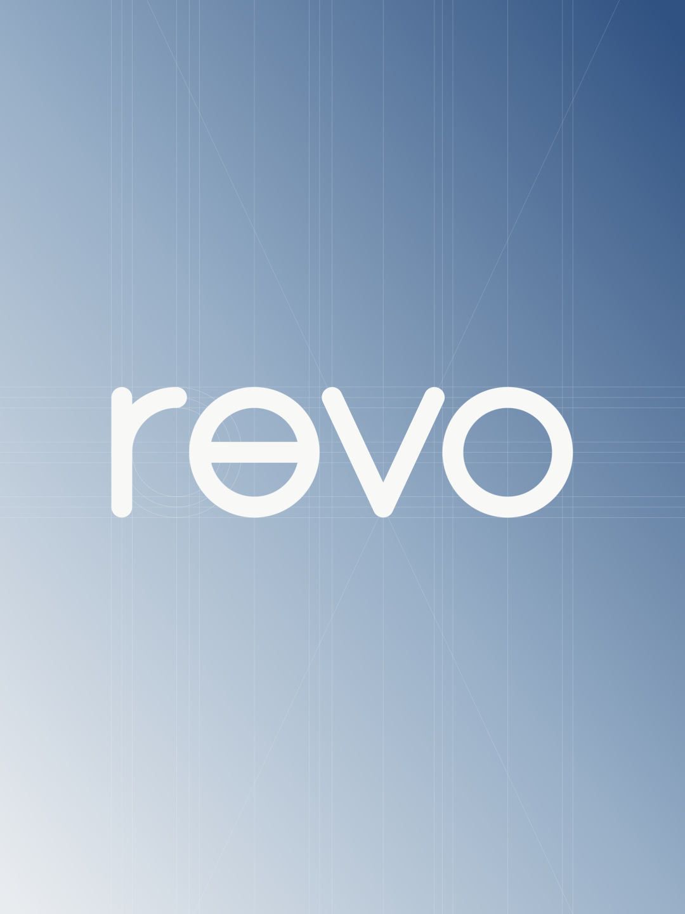

# Revo identity

Revo uses a custom lowercase geometric wordmark. Rounded terminals and a shared
28-unit stroke give it a soft, compact silhouette. The e has a small lower-right aperture
and a central crossbar. The e and o share a 74-unit centerline radius; their
inner and outer construction circles have radii of 60 and 88 units.

The construction sheet exposes those circles, baselines, vertical alignments,
and the v diagonals. These guides belong to the presentation artwork. The app
icon uses the clean wordmark without construction lines. The machine retains
its original Georgia Italic Revo lettering.



## Color

The background blends pearl gray `#E9ECEF`, mist blue `#98AFC7`, and deep sky blue
`#305282`. The white wordmark uses `#F8F9F7`. The powered switch blends `#7197B9`
and `#B9D8EE`, while the counter uses pale blue `#C5E4FA` on a slate-blue display.
The off switch stays neutral silver-gray.

Built-in demo photos and audio waveforms use the same sky-blue family. Actual
image thumbnails retain the colors of the original file.

## Assets

- `Sources/Revo/BrandMark.swift`: vector geometry for the app icon and branding exports.
- `Resources/AppIcon.png`: production 1024-pixel app icon, transparent outside its tile.
- `Resources/Branding/`: editable SVG wordmarks, app icon, and portrait presentations.
- `scripts/render-branding.swift`: deterministic SVG and PNG exporter.
- `Sources/Revo/MenuBarIcon.swift`: the existing monochrome machine silhouette for
  the menu bar, where a four-letter wordmark would be too small.

The wordmark is outlined vector artwork, not a font dependency or an AI-generated
bitmap. All versions are derived from the same geometry.

## Regenerate

```sh
xcrun swiftc -O -parse-as-library Sources/Revo/BrandMark.swift \
  scripts/render-branding.swift -o .build/render-branding
.build/render-branding build/branding
cp build/branding/Revo-AppIcon.png Resources/AppIcon.png
cp build/branding/*.svg Resources/Branding/
cp build/branding/Revo-Wordmark-Navy.png Resources/Branding/
./scripts/build-app.sh
```

The build script creates the macOS icon size variants. The installer background
also uses the exported geometric wordmark and sky-blue accents.
